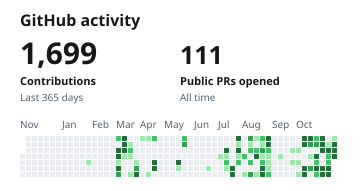

# Medhansh Kapoor

**AI/ML Engineer & Full-Stack Developer** · Manipal University Jaipur

[Portfolio](https://medhanshk.me) · [GitHub](https://github.com/Medhansh-741) · [LinkedIn](https://www.linkedin.com/in/medhansh-kapoor) · [X](https://x.com/medhansh541) · [Email](mailto:medhansh541@gmail.com) · [Résumé](https://medhanshk.me/resume.pdf) · [Book a call](https://cal.com/medhansh541)

<picture>
  <source media="(prefers-color-scheme: dark)" srcset="https://raw.githubusercontent.com/Medhansh-741/Medhansh-741/main/assets/stats-dark.svg">
  
</picture>

[Full contribution history](https://github.com/Medhansh-741#contribution-activity)

## Projects

### EcoAudit

Finds avoidable compute waste with rule-based software checks.

[Code](https://github.com/AWS-env/environmental-hacks/) · [YouTube demo](https://www.youtube.com/watch?v=YWgCT_omVGM) · [Case study](https://medhanshk.me/projects/ecoaudit)

### JanSamadhan

Turns camera detections and citizen reports into repair tickets with follow-up verification.

[Code](https://github.com/Medhansh-741/ps-crmdev1) · [YouTube demo](https://youtu.be/JvkJd1MAV3M) · [Case study](https://medhanshk.me/projects/jansamadhan)

### NyayaAI

Researches Indian law and drafts legal documents with sources and explanations.

[Code](https://github.com/Medhansh-741/NyayAI) · [YouTube demo](https://youtu.be/YwgooAeuRmo) · [Case study](https://medhanshk.me/projects/nyayaai)

## Experience

- **IndiaAI Mission (MeitY)** · AI/ML Intern · June to July 2026

  Built a toolkit to check health research datasets for quality and privacy.
- **ISSA (DRDO)** · Student Trainee · May to July 2026

  Built a mapping platform that works offline on a secure local network.
- **Geminid Systems** · Software Development Intern · May to June 2026

  Built Salesforce integrations and evaluated database query and audio analysis tools.

[Experience and verification](https://medhanshk.me/experience)

## Recognition

- First Prize at Claude Impact Lab Bhopal
- India Innovates ’26 Winner
- Certificate of Student Excellence, Manipal University Jaipur (2026)

[Awards and coverage](https://medhanshk.me/about#achievements)
