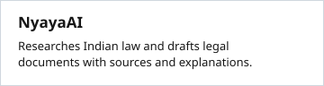
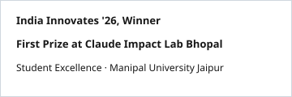

[ Portfolio](https://medhanshk.me) · [ GitHub](https://github.com/Medhansh-741) · [ LinkedIn](https://www.linkedin.com/in/medhansh-kapoor) · [ X](https://x.com/medhansh541) · [ Email](mailto:medhansh541@gmail.com) · [ Résumé](https://medhanshk.me/resume.pdf) · [ Book a call](https://cal.com/medhansh541)

[ Full contribution history](https://github.com/Medhansh-741#contribution-activity)

## Projects

[ Code](https://github.com/AWS-env/environmental-hacks/) · [ Demo](https://www.youtube.com/watch?v=YWgCT_omVGM) · [ Case study](https://medhanshk.me/projects/ecoaudit)

[ Code](https://github.com/Medhansh-741/ps-crmdev1) · [ Demo](https://youtu.be/JvkJd1MAV3M) · [ Case study](https://medhanshk.me/projects/jansamadhan)

[ Code](https://github.com/Medhansh-741/NyayAI) · [ Demo](https://youtu.be/YwgooAeuRmo) · [ Case study](https://medhanshk.me/projects/nyayaai)

## Experience

[ Experience and verification](https://medhanshk.me/experience)

## Recognition

[ Awards and coverage](https://medhanshk.me/about#achievements)
